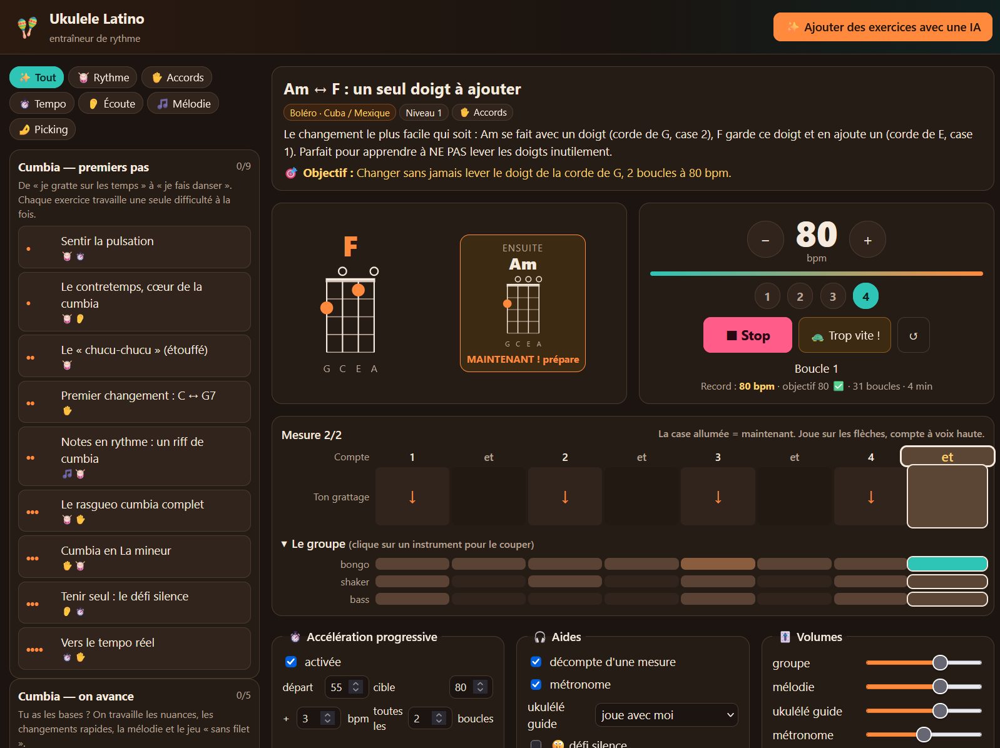
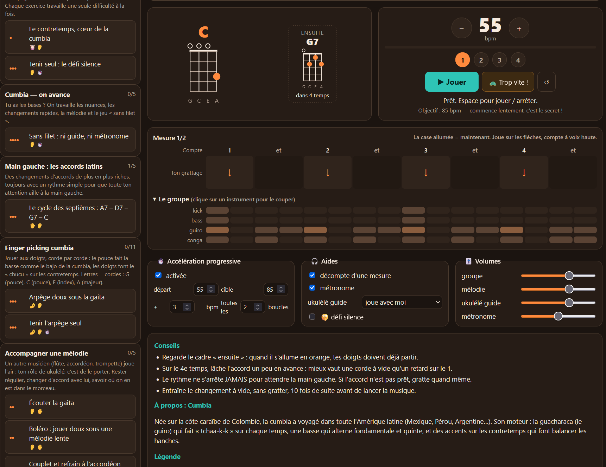

# Ukulele Latino — entraîneur de rythme



Un groupe virtuel (guiro, conga, basse, clave, accordéon, palmas, cajón…) joue avec toi, accélère petit à petit, et t'affiche en temps réel l'accord, le prochain changement et le coup de main droite à jouer. Cumbia, son cubain, bossa nova, reggaeton, cha-cha-chá, boléro, fox-trot, swing guinguette et flamenco (rumba, tangos, sevillanas, soleá, alegrías, bulerías) : **106 exercices**, extensibles avec n'importe quelle IA.

*English version available: the **EN** button in the top bar switches the interface and all exercises to English.*

### ▶ [Jouer en ligne : edu-fpar.github.io/latin-ukulele](https://edu-fpar.github.io/latin-ukulele/)

## Lancer

- **Avec UwAmp** (Apache démarré) : http://localhost/latin-ukulele/
- **Sans UwAmp** : double-clic sur `lancer.cmd` (nécessite Node.js) → http://localhost:8642/
- **En ligne** : **<https://edu-fpar.github.io/latin-ukulele/>** (site 100 % statique, sur GitHub Pages).

> Ouvrir `index.html` directement par double-clic ne marche pas (le navigateur bloque la lecture des fichiers JSON).

Sur téléphone, la liste des exercices s'ouvre avec **📚 Exercices** et une barre de lecture reste en bas de l'écran (tempo, ▶, 🐢).

## Les 6 dimensions travaillées

| Dimension | Comment l'outil t'aide |
|---|---|
| 🥁 Rythme | grille de grattage avec la case « maintenant » allumée, comptage « 1 et 2 et », **toute la boucle** écrite (tablature pour les riffs) avec une mesure à travailler seule d'un clic |
| ✋ Accords | diagramme de l'accord en cours + cadre « ensuite » qui s'allume avant le changement |
| ⏱️ Tempo | accélération automatique (+N bpm toutes les N boucles), bouton « 🐢 Trop vite ! », record sauvegardé |
| 👂 Écoute | pistes du groupe visibles et coupables, guide ukulélé qui s'efface, **défi silence** (1 mesure sur 4 sans rien), **accompagner une mélodie** jouée par une flûte, un accordéon ou une trompette, avec structure couplet/refrain |
| 🎵 Mélodie | riffs en tablature simplifiée (`A3` = corde de La, case 3), notes du riff entourées sur le diagramme d'accord |
| 🤌 Picking | jeu aux doigts corde par corde (`C.F.G.F.` : pouce sur les temps, pincés sur les contretemps), arpèges qui suivent les accords |

**🪜 Variantes** : certains exercices (le contretemps, le premier changement d'accords, les rythmes de base) ont des étapes d'approfondissement, cachées derrière « 🪜 N variantes pour approfondir » dans la liste : un accord de plus, un instrument qui aide en moins, le guide qui s'efface, le défi silence, un tempo plus élevé…

**🔗 Enchaîner** : les exercices (et leurs variantes) se suivent tout seuls, sans cliquer ni sur l'exercice suivant ni sur Jouer, après 4, 8 ou 16 boucles ou une fois le tempo cible atteint. ⏭ (ou la touche N) passe à l'exercice suivant.



## Les parcours

| Parcours | Exercices |
|---|---|
| Cumbia — premiers pas | 16 |
| Cumbia — on avance | 5 |
| Cumbia : les accompagnements (mexicaine, chicha, villera…) | 9 |
| Cumbia : le ukulélé percussionniste | 10 |
| Main gauche : les accords latins | 5 |
| Finger picking cumbia | 11 |
| Accompagner une mélodie | 5 |
| Voyage latino (reggaeton, son, bossa, cha-cha-chá) | 5 |
| Swing guinguette & syncopes (fox-trot de bal, Charleston) | 14 |
| Flamenco : rasgueo (grattage) | 15 |
| Flamenco : arpèges et picado | 11 |

## Ajouter du contenu

Tout est dans des fichiers JSON (`data/`) au même format, appelé « bundle » :
`{ "chords": {...}, "styles": [...], "packs": [ { "exercises": [...] } ] }`.
La spécification complète est dans [docs/prompt-ia.md](docs/prompt-ia.md) ([English](docs/prompt-ia.en.md)).

**Le plus simple** : bouton « ✨ Ajouter des exercices avec une IA » → décris ce que tu veux → « Copier le prompt » → colle-le dans n'importe quelle IA → colle sa réponse → « Vérifier et importer ». Le prompt contient déjà le format, la liste de ce qui existe et ta progression.

**Pour rendre un import permanent** : « ⬇ fichier » dans la liste des imports, place le fichier dans `data/packs/`, ajoute son nom dans `data/manifest.json`.

## Traductions

- **Interface** : `js/i18n.js` (un dictionnaire par langue).
- **Contenu** : les fichiers de `data/` sont en français ; `data/i18n/en/` contient pour chaque fichier un calque qui remplace, par id, les titres, descriptions, objectifs, conseils, noms de sections et de styles. Les rythmes, accords et tempos ne sont écrits qu'une fois.
- **Ajouter une langue** : copier le bloc `en` de `js/i18n.js`, créer `data/i18n/<langue>/` (une IA traduit très bien ces fichiers) et les déclarer dans `data/manifest.json` → `"i18n"`.

## Organisation

```
index.html            page (+ balises Open Graph)
css/style.css         apparence (bureau + vue mobile)
js/i18n.js            textes de l'interface fr / en
js/engine.js          synthèse audio (ukulélé Karplus-Strong, percussions, basse, mélodies)
js/player.js          compilation d'un exercice + horloge précise (Web Audio)
js/app.js             interface, progression, import IA
data/manifest.json    fichiers chargés + traductions
data/chords.json      dictionnaire d'accords (cases G C E A)
data/styles/          un style = des pistes de percussions/basse
data/packs/           parcours d'exercices
data/i18n/en/         traduction anglaise du contenu
docs/prompt-ia*.md    prompt + format donné à l'IA (fr / en)
img/                  captures d'écran
```
